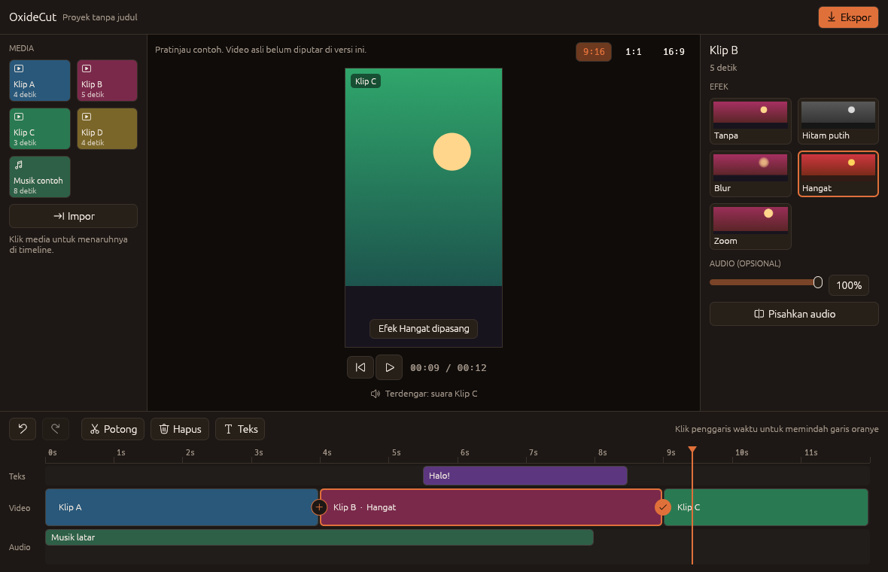

# OxideCut

Editor video untuk Windows yang gratis, open-source, dan langsung pada intinya.
Ditulis dengan Rust. Tanpa watermark.



## Status

Ini versi awal. Yang sudah bisa dicoba:

- Timeline dengan jalur Teks, Video, dan Audio
- Potong, hapus, urungkan dan ulangi
- Tambah teks (isi, ukuran, warna)
- Efek dan transisi dengan contoh langsung
- Pisahkan audio dari video, lalu seret audionya ke mana saja
- Impor berkas ke panel Media

Yang belum: memutar video asli, suara, ekspor MP4, dan simpan proyek.
Untuk sementara tiap klip tampil sebagai gambar contoh berwarna.

## Unduh

1. Buka tab **Releases** di halaman GitHub ini.
2. Unduh `OxideCut-windows-x64.zip`, ekstrak, lalu jalankan `OxideCut.exe`.

Aplikasi ini belum ditandatangani. Kalau Windows menampilkan peringatan,
pilih **More info**, lalu **Run anyway**.

## Aturan desain

Tiap aksi utama paling banyak dua klik, tanpa dialog yang menghalangi,
dan hasilnya langsung terlihat di pratinjau.

| Aksi | Caranya |
| --- | --- |
| Tambah teks | klik Teks, lalu ketik |
| Potong klip | klik penggaris waktu, klik Potong |
| Pasang transisi | klik + di sambungan klip, klik transisi |
| Pasang efek | klik klip, klik efek |
| Pisahkan audio | klik klip, klik Pisahkan audio |

Pintasan: Spasi (putar), Ctrl+Z dan Ctrl+Y, Delete, panah kiri dan kanan.

## Build sendiri

Perlu [Rust](https://rustup.rs) versi stabil terbaru.

```
cargo run --release -p oxidecut-app
cargo test --workspace
```

Peta kode dan aturan pengembangan ada di [CLAUDE.md](CLAUDE.md).

## Lisensi

Kode OxideCut berlisensi [MIT](LICENSE).

Ikon memakai [Fluent System Icons](https://github.com/microsoft/fluentui-system-icons)
dari Microsoft, lisensi MIT (`assets/fonts/FluentSystemIcons-LICENSE.txt`).
Antarmuka dibangun dengan [egui](https://github.com/emilk/egui).
